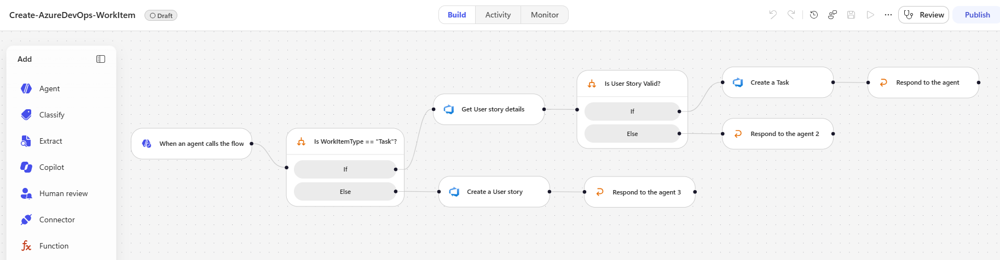
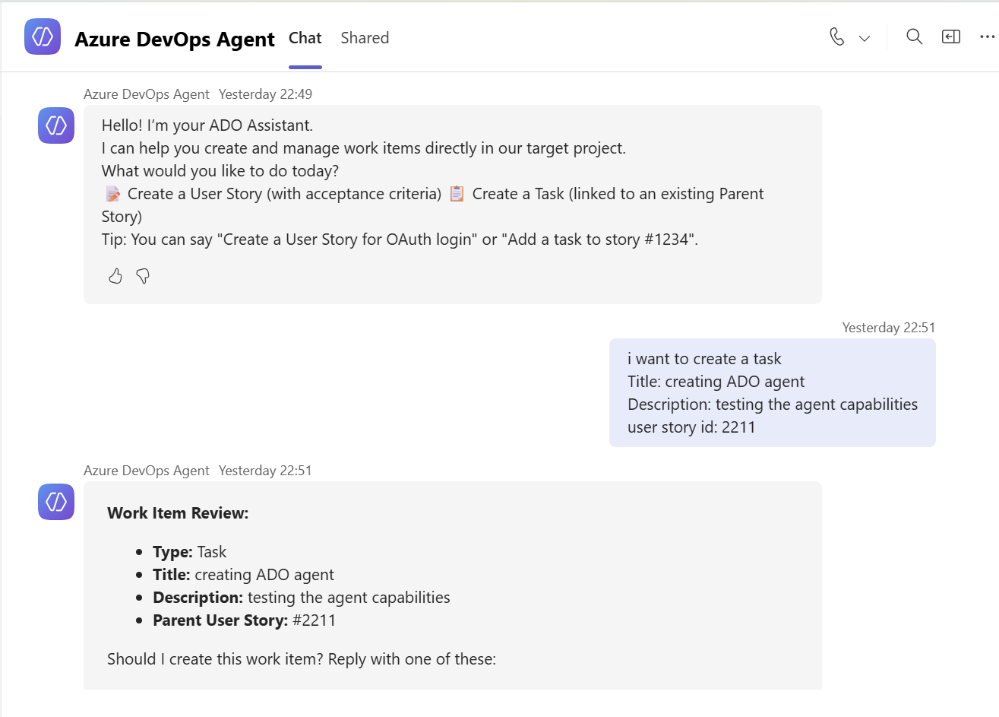
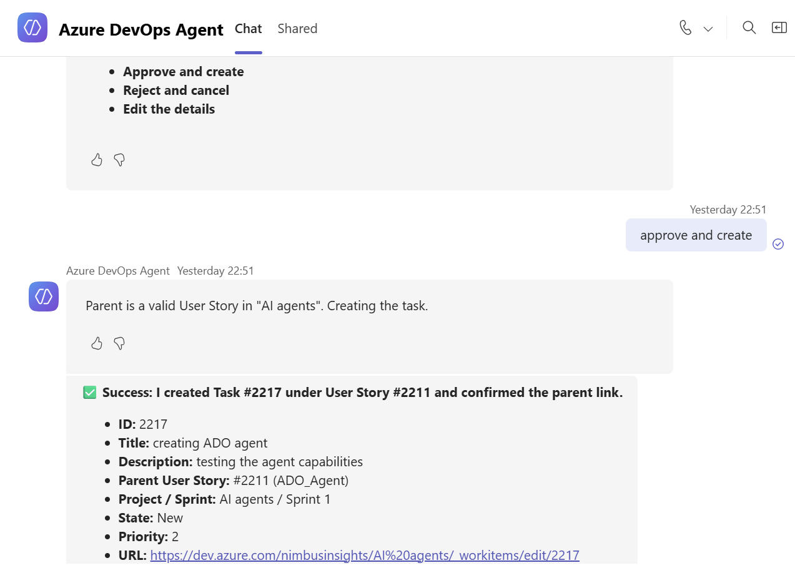

# Azure DevOps Agent (Copilot Studio) 

ADO Agent is a **Copilot Studio AI Agent** that combines real-time Azure Boards knowledge retrieval, live work item lookup, and creates **User Stories** and **Tasks** with parent validation.

---

## Prerequisites

1. **Microsoft Copilot Studio** license and environment with Generative AI features enabled.
2. **Power Automate / Cloud Flow** maker permissions.
3. **Azure DevOps** account with permissions to read/create work items in your target project.

---

## Step-by-Step Deployment Guide


### Step 1: Build the Power Automate Creation Workflow

Create an automated Cloud Flow named **`Create-AzureDevOps-WorkItem`**.

#### 1. Flow Trigger: 

 ### A. *Trigger Type:* : When an agent calls the workflow
Define the following input variables:
- `workItemType` Type of work item to create: User Story or Task
- `title` The title of the work item
- `description` Detailed description and acceptance criteria
- `parentStoryId` Optional parent story ID (required if item type is Task)

### B. *If/Else*

 #### [ Condition 1 ] ── Is workItemType == "Task"?

- `property` workItemType (insert dynamic content)
- `operator` Equals (AND)
- `value` Task
- `run after` check Failed, TimedOut, Skipped

*If True* : Get work item details (add tool)

configure the following
- `organization name`: your-org-name
- `project name`: azure-boards-prj-name
- `work item type`: User Story
- `work item ID`: parentStoryID (insert dynamic content)

*Else* : Create a work item (add tool)

configure the following
- `organization name`: your-org-name
- `project name`: azure-boards-prj-name
- `work item type`: User Story
- Work item details:
  - `Title` title (insert dynamic content)
  - `Description` description (insert dynamic content)

*Respond to the agent*
         • status = "Success"
         • createdUrl = Output.Url
         • message = "User Story created successfully."

 #### [ Condition 2 ] ── to Get work item details (If True) add If/Else

- `property` workItemType (insert dynamic content)
- `operator` Equals (AND)
- `value` User Story

*If True* : create a work item - Task (add tool)

configure the following
- `organization name`: your-org-name
- `project name`: azure-boards-prj-name
- `work item type`: Task
- Work item details:
  - `Title` title (insert dynamic content)
  - `Description` description (insert dynamic content)
  *Respond to the agent*
        • status = "Success"
        • createdUrl = Output.Url
        • message = "Task created successfully under Parent Story."

*Else*:  *Respond to the agent*
         • status = "Failed"
         • createdUrl = ""
         • message = "Validation Error: Parent ID is not a valid User Story."


#### 2. Decision Logic Canvas Setup


### Step 2: Configure Agent in Copilot Studio

1. Open **Copilot Studio** and select **+ Create Agent**.
2. **Agent Name:** `Azure DevOps Agent`
3. **Model Selection:** Select **Claude Sonnet** or **GPT-4o** under **Settings $\rightarrow$ Generative AI** (recommended for strict tool orchestration and instruction adherence).

#### System Instructions

Paste the following instructions from **Instructions** file

---

### Step 3: Connect Knowledge & Tools

1. **Upload Knowledge File:**
   - Go to **Knowledge** $\rightarrow$ **+ Add Knowledge** $\rightarrow$ **Files**.
   - Upload `azure-boards-agile-guide.md`.
   - **Description for AI:** *"Official Azure Boards Agile guidance for writing User Stories, Acceptance Criteria, and Tasks."*

2. **Add Work Item Lookup Tool:**
   - Go to **Tools** $\rightarrow$ **+ Add Tool** $\rightarrow$ Select `Get work item details (V2)`.
   - Set **Organization** and **Project** inputs to your hardcoded target project values.
   - Set Tool Description:
     ```text
     Fetches details (title, description, acceptance criteria, type) of an Azure DevOps work item by ID. Used for answering Q&A about existing items or validating parent User Stories for Tasks.
     ```

3. **Add Work Item Creation Workflow Tool:**
   - Go to **Tools** $\rightarrow$ **+ Add Tool** $\rightarrow$ Select your Power Automate Flow `Create-AzureDevOps-WorkItem`.
   - Set Tool Description:
     ```text
     Creates a User Story or Task in Azure DevOps after performing parent validation. Requires explicit user approval before execution.
     ```

---

## Publish in Teams & Result images




## References & Supporting Documentation

- [Microsoft Copilot Studio Documentation](https://learn.microsoft.com/en-us/microsoft-copilot-studio/)
- [Configure Agent Details & Instructions in Copilot Studio](https://learn.microsoft.com/en-us/microsoft-copilot-studio/agents-experience/authoring-instructions)
- [Azure DevOps Services REST API Documentation](https://learn.microsoft.com/en-us/rest/api/azure/devops/)
- [Azure DevOps Connector in Power Automate](https://learn.microsoft.com/en-us/connectors/azuredevops/)
- [Azure Boards Agile Process Work Item Types](https://learn.microsoft.com/en-us/azure/devops/boards/work-items/about-work-items)

  
---
